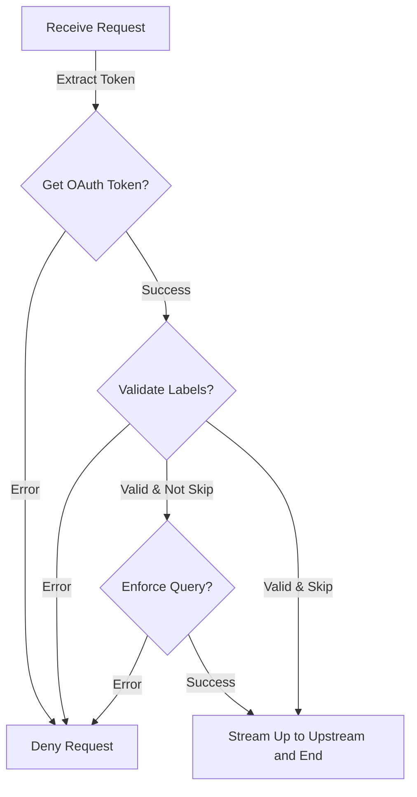
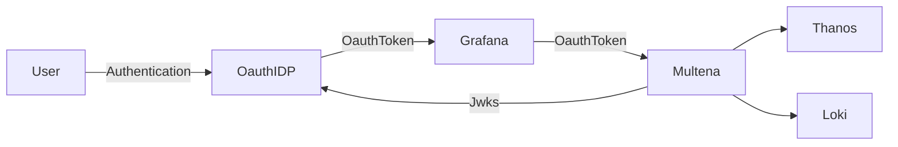

# Multena Proxy

Making the LGTM-Stack **mul**ti **tena**ncy ready

[](https://goreportcard.com/report/github.com/apa-it/multena-proxy)
[](https://github.com/apa-it/multena-proxy/actions/workflows/release.yml)
[](https://godoc.org/github.com/apa-it/multena-proxy)
[](https://github.com/apa-it/multena-proxy/releases/latest)


> This is a fork of [gepaplexx/multena-proxy](https://github.com/gepaplexx/multena-proxy), maintained by APA-IT.

---
**Multena Proxy** is a multi-tenancy ready tool designed to enhance the authorization capabilities of your LGTM (Loki
Grafana Tempo Mimir(Prometheus Style API / OpenMetrics)) stack. Built with LBAC (Label Based Access Control) at its
core.

Multena provides secure and granular user authorization based on assigned tenant labels.
It integrates seamlessly with PrometheusAPI and Loki, and
should support generic oauth provider for identity management. With features like ConfigMap-based configuration,
flexible authorization providers, and multiple tenant labels, Multena ensures that the right data is accessible to the
right users.

---
> __NOTE:__ Multena was initially developed to support OpenShift 4's internal Prometheus, which is powered by Thanos.
> As a result, many references in Multena are made to Thanos, which serves as an API following the Prometheus style.

## How does it work?



In summary, here's how Multena works:

1. Multena receives a request.
2. Multena performs an authorization check in the form of a JWT token validation.
3. If the user is not authorized, Multena denies the query without further processing.
4. If the user is authorized, Multena examines which labels corrispond to the user.
5. If the user has no labels, Multena denies the query without further processing.
6. if the user has labels and its skip (e.g., cluster wide access), it will forward the request to the upstream server
   without further processing.
7. If the user has labels, and it's not a skip, Multena checks if the values in the label match in the query are allowed
   for the user.
8. If the values are not allowed, Multena dienies the request without further processing.
9. If there are no label matches for the tenant label (e.g., namespace), Multena will append the allowed labels to the
   query.
10. If the values are allowed, Multena forwards the query to the specific endpoint or service responsible for processing
    the query.
11. Multena streams the response from the upstream server to the client.

By performing authorization checks, label matching, appending labels, Multena ensures that
users can only query data they are authorized to access.

## Multena Features

| **Feature**                             | **Description**                                                                                                                                                                                            |
|-----------------------------------------|------------------------------------------------------------------------------------------------------------------------------------------------------------------------------------------------------------|
| Authorization Based on Labels           | Enables access control and permissions based on specified labels, ensuring fine-grained access control tailored to your needs.                                                                             |
| Configurable via ConfigMap              | Allows easy configuration of the proxy using a ConfigMap, simplifying setup process and management of configuration settings.                                                                              |
| Flexible Authorization Providers        | Supports both ConfigMap and database label store providers. Choose the provider that best fits your requirements.                                                                                          |
| Integration with PrometheusAPI and Loki | Seamlessly integrates with PrometheusAPI and Loki for efficient authorization. Manage and control access to these powerful observability tools.                                                            |
| Authentication via OAuth                | Authenticate users using a OAuth provider with JWKS (JSON Web Key Set) to ensure secure and reliable authorization.                                                                                        |
| Admin Group Privileges                  | Includes an admin group feature allowing users in the specified admin group to bypass enforcing steps. This is useful for granting administrative privileges to specific users.                            |
| Multiple Tenant Label values            | Supports multiple tenant label values for managing different sets of label values for different tenants. Customize and control access for various groups and users based on their respective tenant label. |
| Strict communication                    | Multena can send either a bearer token in requests to communicate with components protected by OAuth2 proxy or use mutualTLS to ensure a strict and secure communication.                                  |

## Currently queryable

- [x] Metrics
- [x] Logging
- [ ] Traces
- [ ] Profiles

## Request flow

### integrated flow



Jwks is the JSON Web Key Set, which is used to validate the JWT token. It's like a public key for the JWT token.

## Deploy Multena

The Helm chart for Multena is published from this repository via GitHub Pages:
[apa-it.github.io/multena-proxy](https://apa-it.github.io/multena-proxy/).

> **Breaking change:** the chart moved from the upstream `gp-multena` chart (hosted at
> `gepaplexx.github.io/gp-helm-charts`) to this repo's own `multena-proxy` chart. Release and
> values names changed accordingly - see the chart's release notes before upgrading an existing
> deployment.

To install run the following commands:

```bash
helm repo add multena-proxy https://apa-it.github.io/multena-proxy/
helm install multena multena-proxy/multena-proxy -n <grafana-namespace>
```

To upgrade, run the following commands:

```bash
helm repo update
helm upgrade multena multena-proxy/multena-proxy -n <grafana-namespace>
```

> **_NOTE:_** If your using the grafana operator, the helm chart provides an option to install
> grafana-operator-datasources
> which simplifies the deployment of Multena. If you deploy Multena without the grafana-operator-datasources you have to
> configure the datasource manually.

# Configuring Multena

## Labelstore Providers

> **_NOTE:_** Currently Multena offers two different providers for label lookup, namely ConfigMap and MySQL.

### ConfigMap Provider

With the ConfigMap provider, Multena can retrieve labels by reading a separate ConfigMap that defines a list of
allowed labels for each user or group. This approach allows for easy configuration and management of label permissions
by specifying the allowed labels directly in the ConfigMap. An example can be found
here [labels.yaml](./configs/labels.yaml)

You can define the allowed labels for groups and users manually, but if you deploy multena in a single cluster, we
recommend
to use the [multena-rbac-collector](https://github.com/gepaplexx/multena-rbac-collector) to continuesly collect the
permissions
for each user and group. This tool will create a labels.yaml file which can be directly used by Multena.
To enable it set, the following setting

```yaml
rbac-collector:
  enabled: true 
```

in the helm chart.

### MySQL Provider

The MySQL provider enables label lookup through executing a custom
query against a MySQL database. This capability allows Multena to dynamically fetch the allowed tenant lalbel (e.g.,
namespace)
for a specified email or user or groups. By setting the appropriate query in the configuration, Multena can seamlessly
retrieve
the relevant label information from the MySQL database.

This makes only sense if you already have a MySQL database with a systematic way to get the permissions for a user.

> **_NOTE:_** Multena caches labelstore permission lookups by default (see the [Labelstore Cache](#labelstore-cache-labelstore_cache)
> section below), so a given identity's query is only re-run once the cache entry's TTL expires, not on every request.

### config.yaml

#### proxy section

```yaml
web:
  proxy_port: 8080 # port on which the proxy will listen
  metrics_port: 8081 # port on which the metrics will be exposed
  host: localhost # host on which the proxy will listen
  tls_verify_skip: false # skip tls verification for the upstream server, very insecure!!! keep in sync with the Helm chart default.
  trusted_root_ca_path: "./certs/" # path to the trusted root ca
  label_store_kind: "configmap" # kind of label store, currently only configmap and mysql are supported
  jwks_cert_url: https://sso.example.com/realms/internal/protocol/openid-connect/certs # url to the jwks certificate
  oauth_group_name: "groups" # name of the group field in the jwt token
```

#### datasource section (thanos|loki)

```yaml
thanos|loki: # choose either thanos or loki
url: https://localhost:9091 # url to the thanos or loki endpoint     | Required
tenant_label: namespace # label which is used to enforce the query   | Required
cert: "./certs/thanos/tls.crt" # path to the mtls certificate        | Optional
key: "./certs/thanos/tls.key" # path to the mtls key                 | Optional
token: # headers which will be added to the request                 | Optional
  X-Scope-OrgID: "application"
actor_header: "X-Loki-Actor-Path" # header that will be filled with a base64 username/email to enable loki fair usage | Optional 

```

#### logging section

```yaml
log:
  level: 1 # log level, 0 = debug, 1 = info, 2 = warn, 3 = error, -1 = trace exposes sensitive data!!!
  log_tokens: false # DANGEROUS debug-only option: logs raw Authorization/X-Plugin-Id/X-Id-Token headers and jwt in plaintext. Never enable in production!!!
```

#### admin section

```yaml
admin:
  bypass: true # enable bypassing the enforcing steps
  group: gepardec-run-admins # group which is allowed to bypass the enforcing steps
```

#### alert section
Grafana Alerting via Multena
This section enables Grafana alerting functionality through Multena by addressing the limitations of using an OAuth token-secured datasource. When Grafana sends metrics or log requests as part of its alerting process, these requests originate from Grafana itself rather than a user, meaning they lack a valid OAuth token. 
To accommodate this, a fallback header can be configured in this section, allowing Multena to authenticate these requests.

While this fallback introduces a minimal security risk, it is specifically designed to be used only when requests lack a OAuth token. By enabling this feature, you allow Grafana to seamlessly integrate with your Multena setup for alerting purposes while maintaining reasonable security practices.

```yaml
alert:
  enabled: false # enable grafana alerting
  token_header: "X-Multena-alerting" # header which will be filled with the jwt token, as Grafana will not have a oauth token if a user setsup alerting via Grafana alerting.
  alert_cert_url: "https://sso.example.com/realms/internal/protocol/openid-connect/certs" # url to the jwks certificate that will be used to validate the jwt token that is only for alerting
  alert_cert: '{"keys":[{"kid":"","kty":"RSA","alg":"RS256","use":"sig","n":""],"x5t":"","x5t#S256":""}]}' # an extra jwks certificate that will be used to validate the jwt token that is supoosed for alerting but will be also valid for other tokens
```

#### db section

```yaml
db:
  enabled: false # enable connection to a database
  user: multitenant # username for the database
  password_path: "." # path to the password for the database (kubernetes secret)
  host: localhost # host of the database
  port: 3306 # port of the database
  dbName: example # name of the database
  query: "SELECT * FROM users WHERE username = ?" # query to retrieve data from the database, must return a list of labels
  token_key: "email|username|groups" # field in the jwt which will be used to query the database 
```

#### labelstore_cache section

Multena caches `Labelstore.GetLabels` lookups so that a given identity's labels are not re-fetched from the
backend on every proxied request. This is most relevant for the **MySQL** provider, where every uncached
lookup is a database round-trip.

```yaml
labelstore_cache:
  enabled: true # enable TTL caching of labelstore permission lookups; default true
  ttl: 5m # how long a successful lookup is cached; default 5m
  backend: memory # "memory" (default, in-process, no extra dependency) or "redis" (cross-instance, opt-in)
  redis: # only read when backend is "redis"
    address: "localhost:6379" # host:port of the redis server                | Required if backend: redis
    password: "" # redis AUTH password, empty if none                       | Optional
    db: 0 # redis logical DB index                                          | Optional
```

- **Default (`backend: memory`)**: an in-process cache (`patrickmn/go-cache`), no external dependency, no network
  hop. Works out of the box.
- **`backend: redis`**: an opt-in backend for sharing the cache across multiple Multena instances. Requires a
  reachable Redis instance; Multena validates the connection at startup and exits with a clear error if
  `redis.address` is missing or the server is unreachable - it will never silently fall back to "no caching".
  Bring your own Redis instance; Multena does not deploy one.
- **Error handling**: a failed lookup (e.g. a transient MySQL error) is *never* cached, regardless of backend -
  the next request for that identity always retries against the real labelstore.
- **ConfigMap provider**: the cache is never applied to the `configmap` provider. `ConfigMapHandler` already
  serves from an in-memory map that is refreshed instantly via `fsnotify` on ConfigMap changes; adding a TTL
  cache in front of it would only risk serving stale (e.g. just-revoked) permissions until the TTL expires,
  for no round-trip to actually save.
- **Metrics**: `multena_labelstore_cache_hits_total`, `multena_labelstore_cache_misses_total` and
  `multena_labelstore_cache_errors_total` Prometheus counters are exposed on the metrics endpoint
  (`/metrics`) to monitor cache effectiveness.

### labels.yaml

The `labels.yaml` file is used to define the allowed labels for groups and users in Multena. It follows a specific YAML
format as shown below:

```yaml
group1:
  '#cluster-wide': true # this grants the group to skip enforcement
user1:
  hogarama: true # single namespace
user3:
  grafana: true # multi namespace
  opernshift-logging: true
  opernshift-monitoring: true
```

The format consists of a key for username|groupname, followed by another key value pair where the key
is the label and value is true.
This has been done to look up the labels faster.

## How to Configure Multena Proxy

### Step 1: Install/Upgrade Multena Using Helm

Multena can be deployed using its Helm chart. Execute the following commands to install or upgrade Multena:

To **install**:

```bash
helm repo add multena-proxy https://apa-it.github.io/multena-proxy/
helm install multena multena-proxy/multena-proxy -n <grafana-namespace>
```

To **upgrade**:

```bash
helm repo update
helm upgrade multena multena-proxy/multena-proxy -n <grafana-namespace>
```

> **Note**: When using the Grafana operator, the Helm chart provides an option to install `grafana-operator-datasources`
> to simplify the deployment of Multena. If you deploy it without the `grafana-operator-datasources`, you'll have to
> configure the datasource manually.

### Step 2: Choose a Labelstore Provider

Multena offers two types of providers for label lookup - **ConfigMap** and **MySQL**.

#### a. ConfigMap Provider

- Utilizes a separate ConfigMap to define allowed labels for each user/group.
- Labels can be defined manually, or use [multena-rbac-collector](https://github.com/gepaplexx/multena-rbac-collector)
  for automatic collection of permissions.

To enable the use of multena-rbac-collector in the Helm chart:

```yaml
rbac-collector:
  enabled: true 
```

#### b. MySQL Provider

- Performs a custom query against a MySQL database to retrieve allowed tenant labels dynamically for a specified
  user/group.
- Suitable if you have a systematic way to retrieve permissions for a user via a MySQL database.

> **Note**: Enable caching for the database since every query sends a request to it.

### Step 3: Configure `config.yaml`

Multena's `config.yaml` contains crucial configuration sections such as `proxy`, `datasource`, `logging`, `admin`,
and `db`.

#### a. Proxy Section

Define configurations like proxy port, host, TLS verification, and OAuth group name here.

#### b. Datasource Section (Thanos/Loki)

Specify either `thanos` or `loki` and define configurations like URL, tenant label, certificate paths, and headers.

#### c. Logging Section

Manage log level and token logging here.

#### d. Admin Section

Configure if and which group can bypass enforcing steps.

#### e. DB Section

Enable and configure database connections, define query parameters, and specify which JWT field will be used to query
the database.

#### f. Labelstore Cache Section

Configure TTL caching of labelstore permission lookups (`labelstore_cache`), on by default with an in-process
backend; see [labelstore_cache section](#labelstore_cache-section) above for details and the opt-in Redis backend.

## Local Build

A `Makefile` in the repo root mirrors the steps run by CI (`.github/workflows/release.yml`). Requires
Go 1.27.4 (see `go.mod`). Run `make help` to list all targets. The most relevant ones:

```bash
make build      # go build -o multena-proxy .
make test       # go test -race -coverprofile=coverage.out ./...
make coverage   # run tests and enforce the 75% coverage threshold used in CI
make vet        # go vet ./...
make lint       # golangci-lint run (requires golangci-lint v2.15.0 installed locally)
make vulncheck  # govulncheck ./... (installs govulncheck if missing)
make image      # build the container image via build/Containerfile.Build (podman/docker)
make ci         # build + vet + lint + test, a local approximation of the CI pipeline
make clean      # remove the binary and coverage.out
```

`lint` needs `golangci-lint` installed locally (pin the CI version with
`go install github.com/golangci/golangci-lint/v2/cmd/golangci-lint@v2.15.0`). An optional `make helm-lint`
target lints the chart under `charts/multena-proxy` (the dedicated `chart-ci.yml` workflow covers this in CI).

## Releasing

Versioning follows Conventional Commits; the `Next Version (dry-run)` workflow computes and reports
what the next version would be, but tagging/releasing stays a manual, human-approved step. See
[RELEASING.md](RELEASING.md) for the full workflow and commit message convention.


